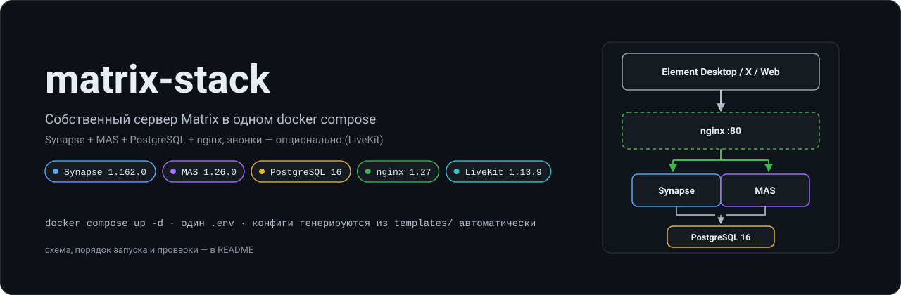
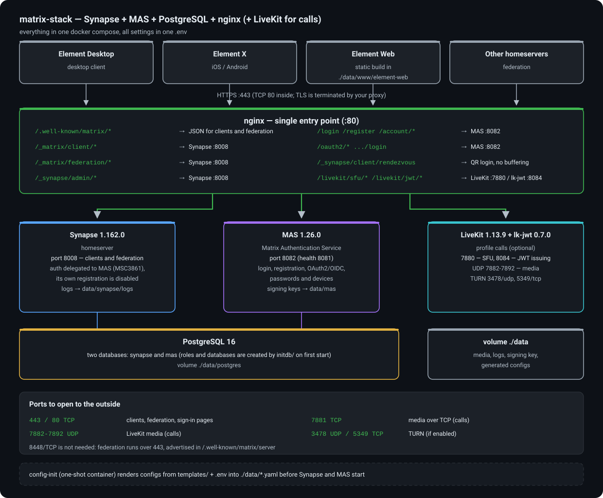
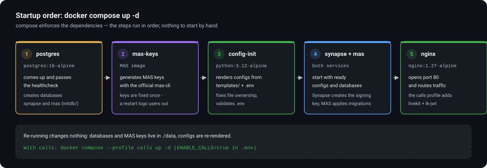
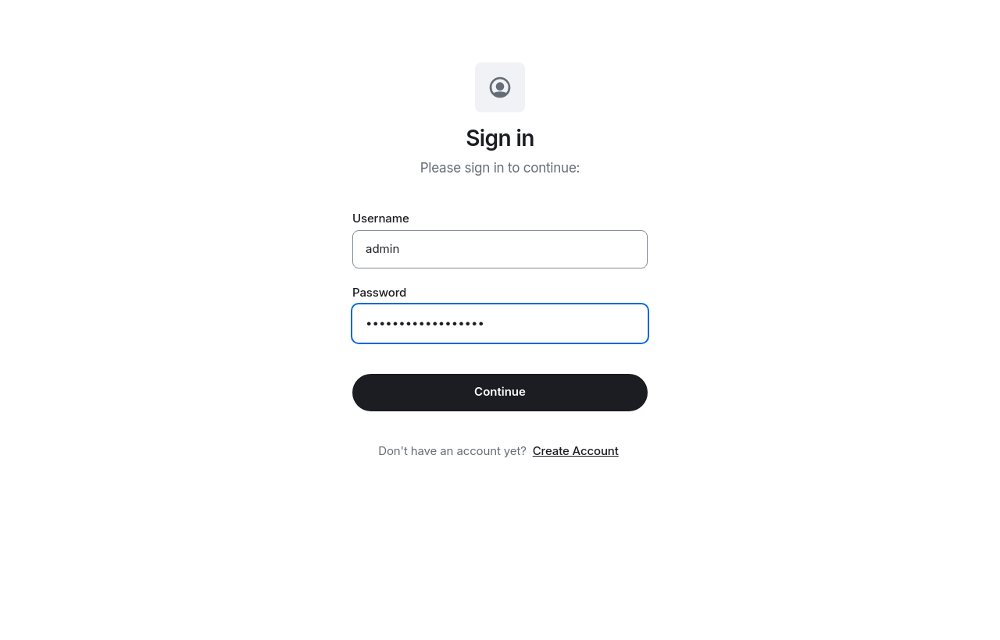
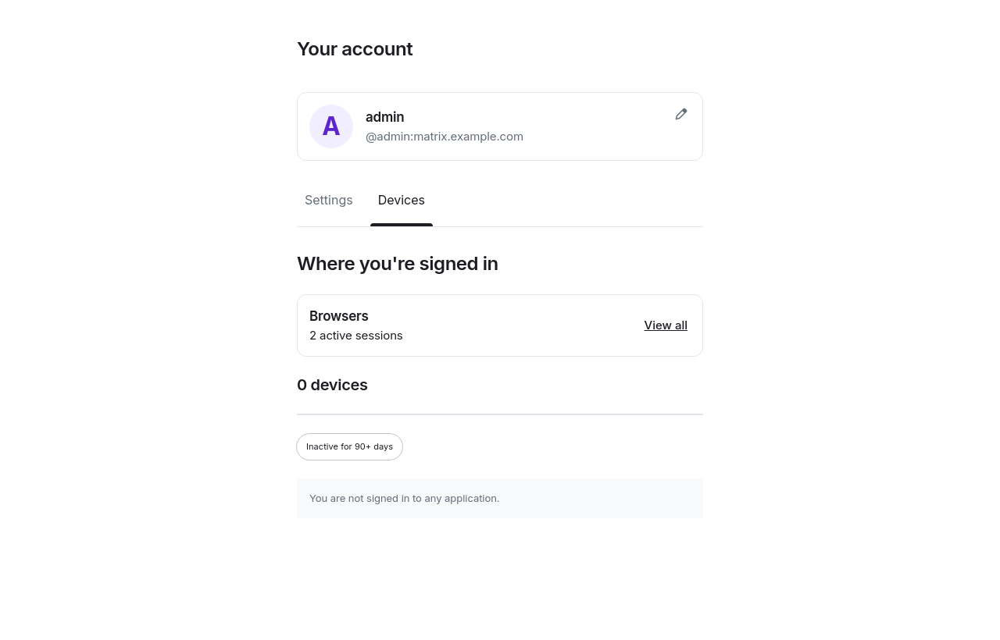

# matrix-stack

A self-hosted [Matrix](https://matrix.org) homeserver that comes up with a single
`docker compose up -d`. Everything is configured through one `.env` file; all service
configs are generated from templates at startup — no hand-editing YAML.

**Synapse + MAS (Matrix Authentication Service) + PostgreSQL + nginx**, with optional
LiveKit for Element Call.

[](LICENSE)


🇷🇺 [Русская версия](README.ru.md)

---

## What's inside

| Component | Image | Role |
|---|---|---|
| Synapse `1.162.0` | `matrixdotorg/synapse` | the homeserver itself |
| MAS `1.26.0` | `ghcr.io/element-hq/matrix-authentication-service` | sign-in / sign-up (OAuth2/OIDC), passwords, devices |
| PostgreSQL `16` | `postgres:16-alpine` | databases `synapse` + `mas` |
| nginx `1.27` | `nginx:1.27-alpine` | single entry point, well-known, routing |
| LiveKit `1.13.9` + lk-jwt `0.7.0` | profile `calls` | voice/video calls (Element Call / Element X) |

Authentication is handled **only by MAS** (MSC3861): Synapse delegates login and
registration to it and has its own registration disabled. Synapse never stores passwords.



Traffic flow: clients and other homeservers → **nginx :80** → either **Synapse :8008**
(`/_matrix/client`, `/_matrix/federation`, `/_synapse/admin`) or **MAS :8082**
(`/login`, `/register`, `/oauth2`, `/account`), both backed by **PostgreSQL**.
`/.well-known/matrix/*` is served by nginx directly.

## Requirements

- Linux with Docker Engine 24+ and Docker Compose v2 (`docker compose version`).
- A domain with an A record pointing at the server (examples use `example.com`).
- Open ports: `80` (or `443` via your TLS terminator); `8448` is **not** required —
  federation runs over 443 and is advertised through `/.well-known/matrix/server`.
- Minimum 2 GB RAM, 10 GB disk. Calls need more and a public IP.
- ~2.5 GB of traffic for the first image pull.

> **Windows / macOS.** The stack itself runs fine (including from PowerShell), but
> `scripts/generate-env.sh` is a shell script: run it under WSL or Git Bash, or just
> copy `.env.example` to `.env` and fill the `CHANGEME_*` values with random strings
> (`openssl rand -hex 32`). File-ownership checks are skipped there — that is expected.

## Quick start

```bash
cd matrix-stack

# 1) generate secrets (creates .env, fills every password/key)
./scripts/generate-env.sh

# 2) set the TWO mandatory values
nano .env
#    SERVER_NAME=example.com             <- your domain
#    PUBLIC_BASE_URL=https://example.com <- URL with scheme, no trailing slash

# 3) bring it up
docker compose up -d

# 4) check
docker compose ps
docker compose logs -f config-init   # config rendering; ends with "all configs ready"
```



Wait 30–60 seconds, then verify:

```bash
curl -s http://127.0.0.1:${HTTP_PORT:-80}/_matrix/federation/v1/version   # Synapse version
curl -s http://127.0.0.1:${HTTP_PORT:-80}/.well-known/matrix/client      # client config
```

Or in one line (port taken from `.env`):

```bash
set -a; . ./.env; set +a; curl -s "http://127.0.0.1:${HTTP_PORT}/_matrix/client/versions" | head -c 300
```

Startup order is enforced by compose: `postgres (healthy) → mas-keys → config-init →
synapse/mas → nginx`. `mas-keys` and `config-init` are one-shot helpers and show up as
`Exited (0)` in `docker compose ps` — that is normal.

## Repository layout

```
.
├── docker-compose.yml
├── .env.example           # settings template (copied to .env)
├── initdb/01-databases.sh # roles and databases created on first PostgreSQL start
├── scripts/
│   ├── generate-env.sh    # .env + random secrets (runs on the host)
│   └── render.py          # renders configs from templates (runs in a container)
├── templates/             # SINGLE SOURCE OF TRUTH for configs
│   ├── homeserver.yaml.tmpl
│   ├── mas-config.yaml.tmpl
│   ├── livekit.yaml.tmpl
│   ├── nginx-site.conf.tmpl
│   ├── log.yaml
│   └── well-known-server.json.tmpl
├── docs/img/              # diagrams and screenshots used in this README
└── data/                  # state (created at runtime, NOT in git)
    ├── postgres/          # databases
    ├── synapse/           # homeserver.yaml (rendered), media/, logs/, signing key
    ├── mas/               # config.yaml + generated.yaml (MAS keys)
    ├── livekit/           # config.yaml
    ├── nginx/default.conf
    └── www/               # .well-known, index.html, element-web/, admin/
```

**Change settings only in `templates/` and `.env`**, then:

```bash
docker compose up -d config-init --force-recreate   # re-render configs
docker compose restart synapse mas                   # apply
```

Files inside `data/` are overwritten on every render — do not edit them by hand.

## DNS and TLS

DNS: a single A record `example.com → server IP`. The rest is advertised via well-known:

```bash
curl -s https://example.com/.well-known/matrix/server   # {"m.server": "example.com:443"}
```

TLS is deliberately **not** part of this bundle — there are too many ways to do it.

- **You already have a proxy** (Nginx Proxy Manager, Caddy, Traefik, cloud LB): point the
  domain at `http://IP:${HTTP_PORT}` and enable WebSockets plus the headers
  `X-Forwarded-For` / `X-Forwarded-Proto: https`. Nothing else is needed.
- **No proxy**: the quickest path is Caddy in front of compose
  (`caddy reverse-proxy --from example.com --to 127.0.0.1:80`), or add a certbot service
  and mount the certificates into the nginx container.

If TLS terminates outside this nginx, make sure `PUBLIC_BASE_URL=https://...` — MAS signs
tokens with that address, and a mismatch makes clients fail with `invalid issuer`.

## Users, admin rights, registration

Registration goes through MAS. By default `.env` sets
`REGISTRATION_TOKEN_REQUIRED=true` — sign-up requires a one-time token.

All `mas-cli` commands work without `-c`, because compose sets `MAS_CONFIG=/data/config.yaml`.

```bash
# one-time registration token (valid 1 hour) — hand it to the user
docker compose exec mas mas-cli manage issue-user-registration-token

# create a user directly, without the web form
docker compose exec mas mas-cli manage register-user alice -y -p 'Your-Password-Here'

# users allowed to REQUEST admin privileges
docker compose exec mas mas-cli manage list-admin-users

# grant / revoke admin
docker compose exec mas mas-cli manage promote-admin alice
docker compose exec mas mas-cli manage demote-admin alice

# reset password, lock account, kill sessions
docker compose exec mas mas-cli manage set-password alice
docker compose exec mas mas-cli manage lock-user alice
docker compose exec mas mas-cli manage kill-sessions alice
```

Users sign in to their client (Element Desktop / Element X) using `PUBLIC_BASE_URL` and
enter their login, password and the registration token. The same MAS UI serves the web
sign-in and account pages:

| Sign-in page (`/login`) | Account page (`/account/sessions`) |
|---|---|
|  |  |

*(screenshots from the test run described below — the domain there is a placeholder)*

### How admin rights actually work (easy to get wrong)

- `policy.data.admin_users` (the `ADMIN_USER` value from `.env`) is only the list of users
  allowed to **request** admin privileges. Being on that list grants nothing by itself —
  `list-admin-users` says «can request admin privileges».
- Actual rights are granted by `promote-admin`.
- In this setup, admin rights are an **OAuth scope**: Synapse treats you as a server admin
  only if the token carries `urn:synapse:admin:*` (verified in Synapse source,
  `synapse/api/auth/mas.py`: `is_server_admin` → `"urn:synapse:admin:*" in requester.scope`).
  The scope is requested by the client during the OAuth flow and baked into the issued token.
- Therefore **a plain username/password login does not give you `/_synapse/admin/` access** —
  even right after `promote-admin` and re-login we got `403 You are not a server admin`
  (the token was issued without the admin scope). Administer through MAS instead: `mas-cli`,
  the admin panel (Ketesa) or the MAS admin API.
- `REGISTRATION_TOKEN_REQUIRED=false` opens registration to everyone (useful for closed tests).

### Finding other users

You can invite or search remote users only by full MXID (`@user:other.domain`). Searching by
display name does not work by design: a client searches the local directory only, and that
directory contains just this server's users.

## Web client and admin panel (optional)

nginx is already configured to serve:

- `https://example.com/element-web/` → drop an Element Web build into `data/www/element-web/`
  and set in its `config.json`:
  `{"default_server_config":{"m.homeserver":{"base_url":"https://example.com"}},
  "oidc_client_id":"<OIDC_CLIENT_ID from .env>"}`.
- `https://example.com/admin/` → a static admin panel build (e.g. Ketesa) in `data/www/admin/`.

Leave them empty and you simply get 404s — nothing else in the stack is affected.

## Calls (profile `calls`)

```bash
# in .env: ENABLE_CALLS=true  (LIVEKIT_KEY/SECRET are already generated)
docker compose up -d config-init --force-recreate
docker compose --profile calls up -d
```

Ports to open for media:

| Port | Protocol | Purpose |
|---|---|---|
| 7881 | TCP | ICE/media over TCP |
| `${RTC_RANGE_START}-${RTC_RANGE_END}` (default 7882–7892) | UDP | media |
| `${TURN_UDP_PORT}` (3478) | UDP | TURN (if `TURN_ENABLED=true`) |
| `${TURN_TLS_PORT}` (5349) | TCP | TURN/TLS (if `TURN_ENABLED=true`) |
| 443 | TCP | `/livekit/sfu` (WebSocket) through your proxy |

Verify: `curl -s https://example.com/livekit/jwt/healthz` → `OK`.

Watch out:

- `LIVEKIT_JWT_BIND` **must** be `0.0.0.0:8084`. With `localhost` the service binds to
  IPv6 loopback and nginx cannot see it (already set correctly in this compose).
- Behind NAT, set `NODE_IP` to your public IP, otherwise media is advertised on the internal
  address and calls connect «without audio/video».
- With an empty `NODE_IP`, the UDP range **must** contain more than one port: LiveKit picks a
  random port from the range and panics with `invalid argument to Intn` on a single-port range
  before it even starts. A single port is allowed only together with `NODE_IP`. `config-init`
  validates this and stops with a clear message.
- lk-jwt is pinned to `0.7.0`: `0.8.0` changed the `/get_token` format and breaks older
  clients. When upgrading, test a call in Element X.
- TURN needs a valid certificate for the domain: either an external proxy with TLS on 5349,
  or `TURN_EXTERNAL_TLS=false` (clients will complain about a self-signed cert).

## Federation

```bash
curl -s "https://federationtester.matrix.org/api/report?server_name=example.com" | \
  python3 -m json.tool | grep -E '"FederationOK"|"ServerName"|"error"'
```

Expected: `"FederationOK": true`. If it is `false`, the culprit is almost always the external
proxy: it does not serve `/.well-known/matrix/server`, does not pass `X-Forwarded-Proto`, or
blocks `POST /_matrix/federation/v1/send/...`.

Manual check from another machine:

```bash
curl -s https://example.com/_matrix/key/v2/server | head -c 200
curl -s -o /dev/null -w '%{http_code}\n' https://example.com/_matrix/federation/v1/version
```

## Maintenance

```bash
# logs
docker compose logs -f synapse            # console
tail -f data/synapse/logs/homeserver.log  # file (50 MB × 5 rotation) — more reliable

# status
docker compose ps
docker compose exec synapse curl -s localhost:8008/_matrix/client/versions

# backup (at minimum: databases + signing key; without the key federation silently breaks)
docker compose exec -T postgres pg_dump -U matrix synapse | gzip > synapse-$(date +%F).sql.gz
docker compose exec -T postgres pg_dump -U matrix mas     | gzip > mas-$(date +%F).sql.gz
sudo tar czf matrix-data-$(date +%F).tgz data/synapse/homeserver.signing.key \
     data/config data/mas/generated.yaml

# upgrade
sed -i 's/^SYNAPSE_IMAGE=.*/SYNAPSE_IMAGE=matrixdotorg\/synapse:v1.163.0/' .env
docker compose pull && docker compose up -d

# full stop (data is kept)
docker compose down
# wipe EVERYTHING including databases:  docker compose down && sudo rm -rf data
```

Component versions are pinned in `.env` (`SYNAPSE_IMAGE`, `MAS_IMAGE`, …) so that upgrades
are a deliberate action rather than a surprise.

## Troubleshooting

| Symptom | Cause and fix |
|---|---|
| `Invalid MAC` / 500 in Synapse logs | `MAS_MATRIX_SECRET` differs between `homeserver.yaml` and the MAS config. Check `config-init` output: it validates this and fails. |
| Only local users work, federation `FederationOK: false` | External proxy: missing `/.well-known/matrix/server` or `X-Forwarded-Proto` not forwarded. |
| `{"errcode":"M_UNRECOGNIZED"}` on login | The request bypasses MAS. Check the nginx locations `^/_matrix/client/(v1|v3|unstable)/(login\|logout\|refresh)`. |
| CSS/images on sign-in pages do not load | nginx does not proxy `/assets/` and `/oauth2/` to MAS. |
| Password reset / emails never arrive | `EMAIL_ENABLED=false` — no mail is sent at all. Enable it and check that SMTP keys sit **flat** in the `email:` section (the nested form is silently ignored, SMTP answers `send AUTH command first`). |
| QR login («Link device») fails | Needs `msc4108_enabled: true` (set) and non-buffered `rendezvous` locations (set). |
| Ports are busy, `docker compose up` fails | Change `HTTP_PORT` (and `RTC_RANGE_START/END`, `TURN_*_PORT`) in `.env`. |
| LiveKit restart-looping, `panic: invalid argument to Intn` | `RTC_RANGE_START == RTC_RANGE_END` with an empty `NODE_IP`. Widen the range or set `NODE_IP`. |
| nginx will not start: `host not found in upstream` | Call upstreams were rendered from something other than the template (the template uses `resolver`). Re-render: `docker compose up -d config-init --force-recreate`. |
| Synapse restart-looping, `PermissionError: /data/homeserver.signing.key` | `data/synapse` is owned by root while Synapse runs as uid 991. `config-init` fixes ownership; if you started compose without it, run `sudo chown -R 991:991 data/synapse`. |
| `mas-cli` in container: `could not connect to the database` | Missing `MAS_CONFIG` (already set in this compose) — or pass `-c /data/config.yaml`. |
| `403 You are not a server admin` on `/_synapse/admin/` | The token has no `urn:synapse:admin:*` scope — see «Users, admin rights». Administer through MAS. |
| Config changes had no effect | You forgot `docker compose up -d config-init --force-recreate` + `restart synapse mas`. |
| Call connects but has no media | NAT: `NODE_IP` not set, or the UDP range is closed. |

## What is not included

- **TLS certificates** — bring your own (see «DNS and TLS»).
- **Web client and admin panel** — drop static builds into `data/www/`.
- **TURN as a separate service** — TURN is built into LiveKit (`TURN_ENABLED=true`).
- **Bridges** (IRC/Slack/Telegram) and bots — install on top of this stack.
- **Automatic backups** — commands above; wire them into cron yourself.

## Verified end-to-end

This bundle is not just written — it was brought up and exercised on a clean machine
(Ubuntu, Docker 29.9 / Compose v5.6, all seven containers).

| Check | Result |
|---|---|
| `docker compose up -d` from scratch, all containers | `postgres` healthy, `synapse` healthy, `mas` up, `nginx` up, `livekit` up, `lk-jwt` healthy |
| `GET /_matrix/client/versions` through nginx | 200, version list |
| `GET /_matrix/federation/v1/version` | `{"server":{"name":"Synapse","version":"1.162.0"}}` |
| `GET /.well-known/matrix/server` and `/client` | valid JSON, `m.server`, MSC2965 block |
| `GET /_matrix/client/v3/login` | 200, flows `m.login.password` + `m.login.sso` — i.e. served by MAS |
| MAS health (`http://mas:8081/health`) | `ok` |
| User registration (`mas-cli manage register-user`) | `User registered user.id=01M4XZ4PZ1…` |
| Sign-in `POST /_matrix/client/v3/login` | 200, `user_id=@admin:…`, `device_id`, token `mct_…` |
| `GET /_matrix/client/v3/account/whoami` | 200, correct `user_id` |
| `POST /_matrix/client/v3/createRoom` | 200, `room_id` |
| `GET /_matrix/client/v3/devices` | 200 |
| User provisioned into the Synapse DB | `@admin:matrix.test.local` appears in the `users` table |
| `lk-jwt` `GET /livekit/jwt/healthz` through nginx | 200 |
| LiveKit through nginx (`/livekit/sfu/`) | 200 |
| Stack **without** the `calls` profile | nginx starts, core API 200, `/livekit/*` → 502 (not a crash) |
| Web UI through nginx (`/login`, `/account/sessions`) | both pages render, sign-in with the created user works |

A side effect of that run was four pitfalls that break such a stack out of the box — all
fixed and documented above:
1. the MAS image has no shell and runs as uid 65532;
2. Synapse forces uid 991 against a root-owned bind mount;
3. LiveKit panics on a single-port UDP range;
4. nginx refuses to start when an optional service's upstream cannot be resolved.

## Design decisions worth knowing

- **MAS keys are not generated by hand.** `render.py` calls the official
  `mas-cli config generate` and takes only the `secrets:` block (signing and encryption
  keys). Their format is specific; a handmade one breaks MAS.
- **Admin rights live in MAS**, not Synapse: `policy.data.admin_users` (plus `ADMIN_USER`).
  This follows from MSC3861 — Synapse stores no passwords.
- **`exclude_remote_users: true`** in `user_directory` — remote users do not pollute search,
  while inviting by full MXID still works.
- **Synapse logs go to disk** (`data/synapse/logs/`), not just to console; otherwise there is
  nothing to investigate after a container restart.
- **Media retention** is on (30 days local, 7 days remote) so the disk is not filled by
  federation junk.
- **`trusted_proxies: 172.16.0.0/12`** in MAS — the docker network nginx connects from.
  Adjust if you change compose subnets.

## License

MIT — see [LICENSE](LICENSE).

Matrix, Synapse and Element are projects of the Matrix.org Foundation and Element HQ;
this repository only packages their official images.
